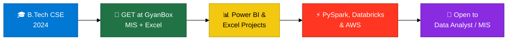

---

## 💫 About Me

Computer Science graduate (B.Tech, 2024) based in Satna, Madhya Pradesh. I turn raw business data into clear dashboards and reports that help teams make faster, better decisions. My core toolkit is Advanced Excel, Power BI and SQL, backed by working knowledge of PySpark, Databricks and AWS.

> [!TIP]
> 🎯 **Open to:** Data Analyst and MIS Executive roles. Reach me at **devanshudwivedi619@gmail.com**

- 💼 **Experience:** Graduate Engineer Trainee at **GyanBox Digital** (Dec 2025 - Jul 2026), working on MIS reporting, data validation and Excel-based analysis
- 📊 **Core skills:** Advanced Excel, Power BI (DAX, interactive dashboards), SQL
- ⚡ **Big data and cloud:** PySpark on Databricks, AWS (S3, EC2, IAM, Lambda)
- 🌱 **Currently learning:** Python (Pandas, NumPy) and AI/ML fundamentals

---

## 🏆 Highlights

- **Superstore Sales & Profit Insights (Power BI):** analysed $8.95M in sales across product categories, customer segments and geography
- **IT Spend & Asset Utilization Dashboard (Power BI):** tracked 300 assets across 5 departments and identified 2,778 unused licenses (31%)

---

## 🛠️ Technical Skills

| Area | Tools | Proficiency |
|---|---|---|
| **Data analysis & reporting** | Advanced Excel (Pivot Tables, Slicers, MIS reports) | Advanced |
| **Business intelligence** | Power BI (DAX, interactive dashboards, KPIs) | Proficient |
| **Databases** | SQL (MySQL) | Basic to Intermediate |
| **Big data** | PySpark, Databricks | Working knowledge |
| **Cloud** | AWS: S3, EC2, IAM, Lambda | Working knowledge |
| **Programming** | Python (Pandas, NumPy, Matplotlib) | Learning |

### 🧭 My Journey

---

## 📊 Dashboard Snapshots

License Utilization and Projects by Tool use data from my real projects. Charts tagged SAMPLE show the style of dashboards I build, with illustrative numbers.

---

## 📁 Projects

| Project | Tools | Link |
|---|---|---|
| 🛒 Superstore Sales & Profit Insights Dashboard |  | [View](https://github.com/devanshudwivedi619/Superstore-Sales-Profit-Insights-Dashboard-) |
| 📊 Business Intelligence Dashboard (Sales 2018-2021) |  | [View](https://github.com/devanshudwivedi619/Business-Intelligence-Dashboard) |
| 👥 HR Employee Analytics Dashboard |  | [View](https://github.com/devanshudwivedi619/-HR-Employee-Analytics-Dashboard-Power-BI-) |
| 👕 Vedu Store Report Dashboard |  | [View](https://github.com/devanshudwivedi619/VEDU-STORE-REPORT-DASHBOARD) |
| 📈 Sales Analysis |  | [View](https://github.com/devanshudwivedi619/Sales-Analysis-) |
| 🚲 Bike Rental Project |  | [View](https://github.com/devanshudwivedi619/Bike-Rental-Project) |

---

## 💻 Tech Stack

