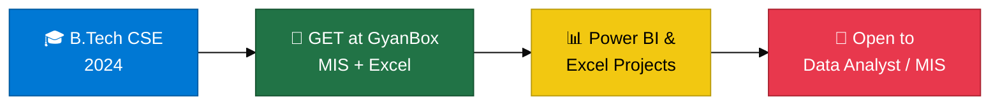
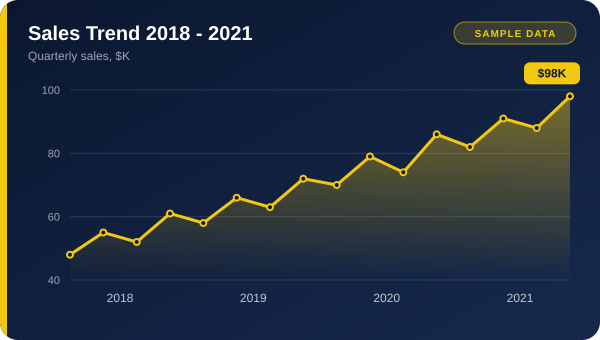
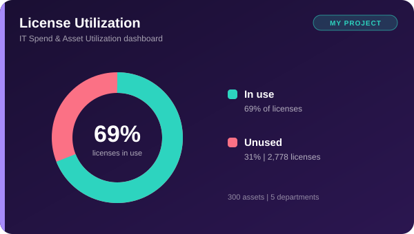
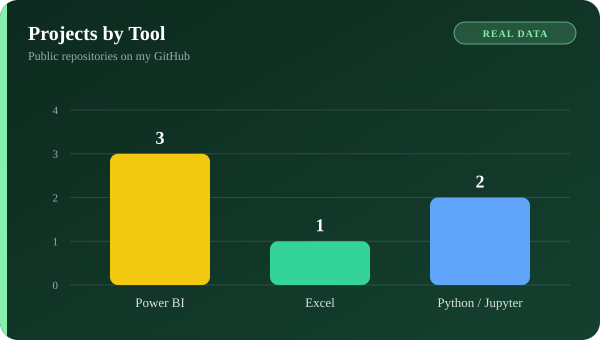
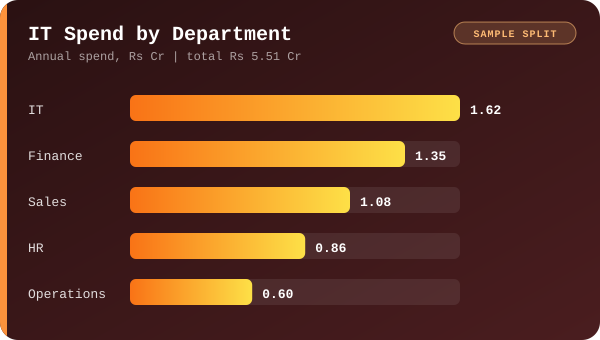
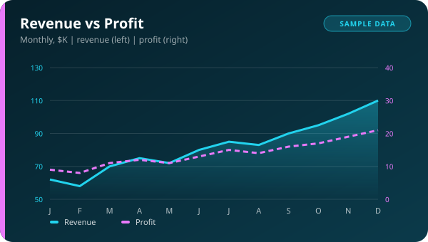

---

## 💫 About Me

B.Tech Computer Science graduate (2024) from Satna, Madhya Pradesh. Mujhe messy business data ko clear dashboards aur reports mein badalna pasand hai, jinse log asaani se decision le sakein.

> [!TIP]
> 🎯 **Looking for:** Data Analyst / MIS Executive roles. Mujhse email par seedha contact karo: **devanshudwivedi619@gmail.com**

- 💼 **Experience:** Graduate Engineer Trainee at **GyanBox Digital** (Dec 2025 - Jul 2026): MIS reporting, data validation, Excel-based analysis
- 📊 **Skills:** Advanced Excel, Power BI (DAX, interactive dashboards), SQL
- 🌱 **Learning:** Python (Pandas, NumPy) aur AI/ML ki basics

---

## 🏆 Highlights

- **Superstore Sales & Profit Insights (Power BI):** $8.95M sales ka analysis product categories, customer segments aur geography ke hisaab se
- **IT Spend & Asset Utilization Dashboard (Power BI):** 300 assets aur 5 departments mein 2,778 unused licenses (31%) pakde

---

## 🛠️ Skills at a Glance

| Skill | Level | Used for |
|---|---|---|
|  |  | Pivots, slicers, MIS reports, dashboards |
|  |  | Interactive dashboards, KPIs |
|  |  | Querying and analysis |
|  |  | Pandas, NumPy, Matplotlib |

### 🧭 My Journey

---

## 📊 Dashboard Snapshots

License Utilization and Projects by Tool come from my real projects. Charts tagged SAMPLE show the style of dashboards I build, with illustrative numbers.

---

## 📁 Projects

| Project | Tools | Link |
|---|---|---|
| 🛒 Superstore Sales & Profit Insights Dashboard |  | [View](https://github.com/devanshudwivedi619/Superstore-Sales-Profit-Insights-Dashboard-) |
| 📊 Business Intelligence Dashboard (Sales 2018-2021) |  | [View](https://github.com/devanshudwivedi619/Business-Intelligence-Dashboard) |
| 👥 HR Employee Analytics Dashboard |  | [View](https://github.com/devanshudwivedi619/-HR-Employee-Analytics-Dashboard-Power-BI-) |
| 👕 Vedu Store Report Dashboard |  | [View](https://github.com/devanshudwivedi619/VEDU-STORE-REPORT-DASHBOARD) |
| 📈 Sales Analysis |  | [View](https://github.com/devanshudwivedi619/Sales-Analysis-) |
| 🚲 Bike Rental Project |  | [View](https://github.com/devanshudwivedi619/Bike-Rental-Project) |

---

## 💻 Tech Stack

